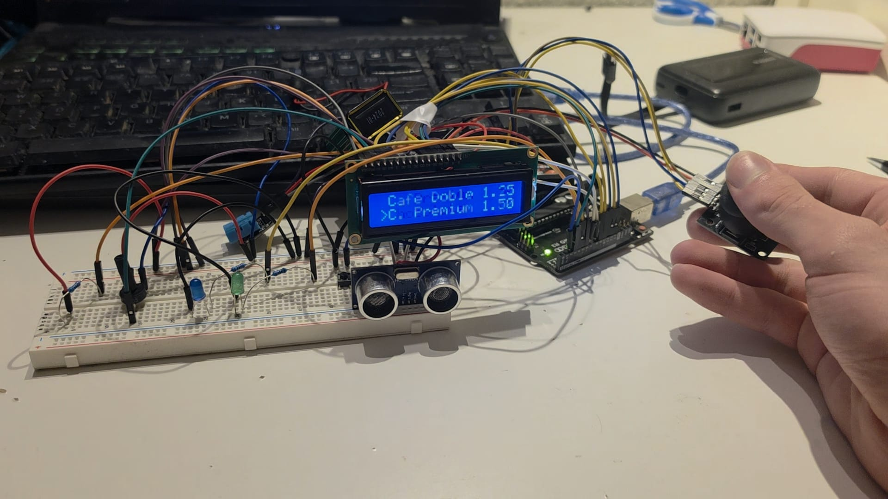
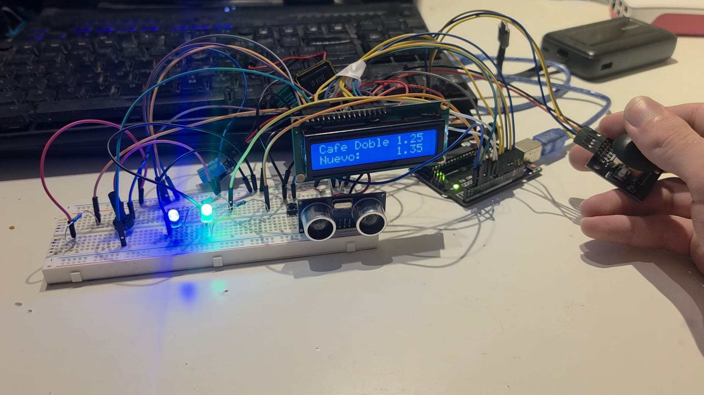
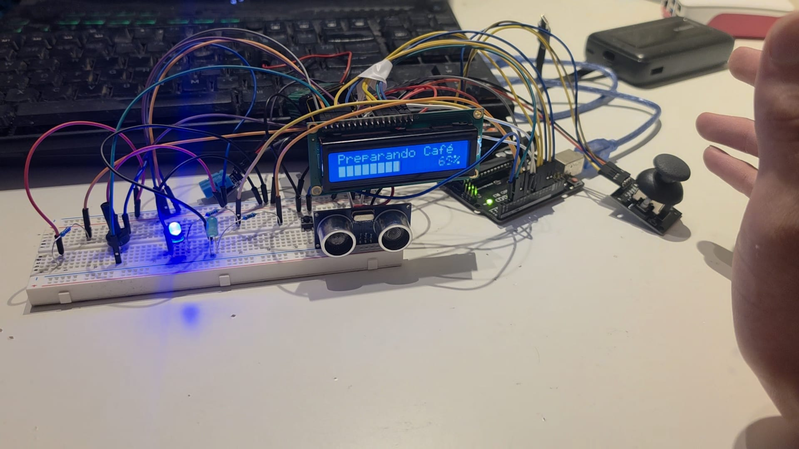
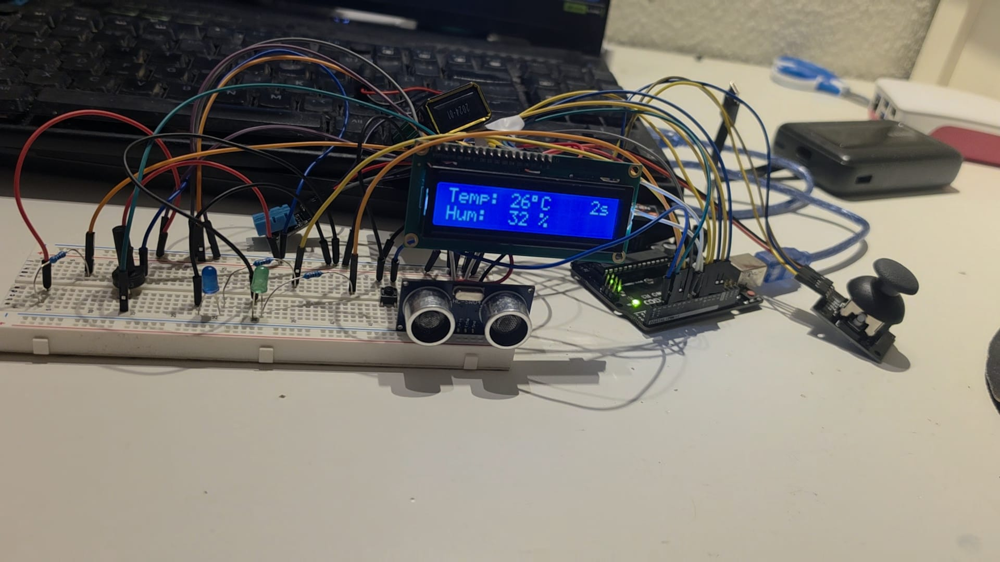
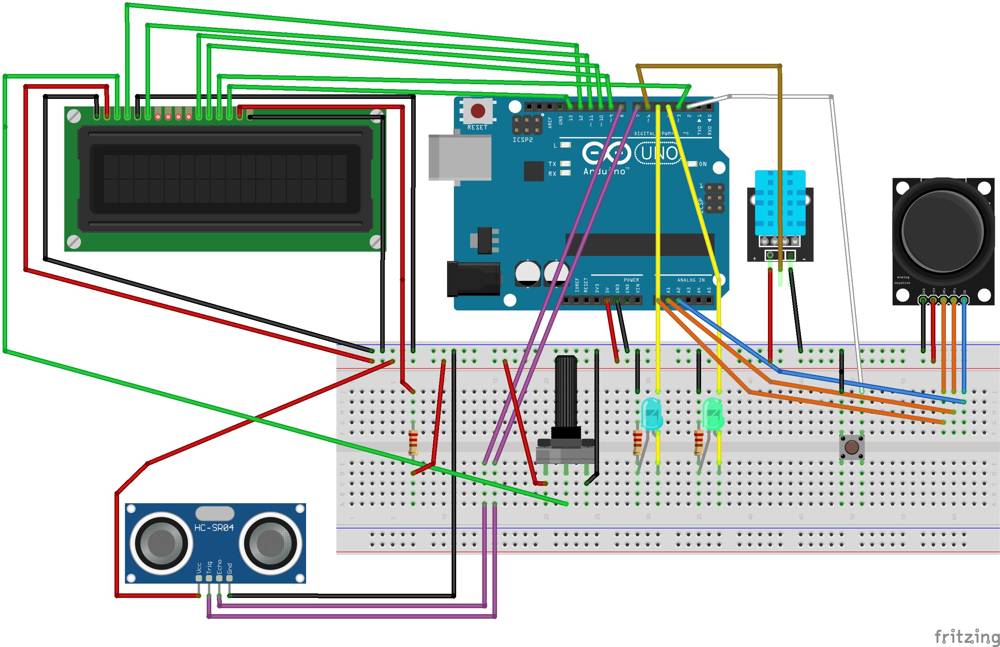
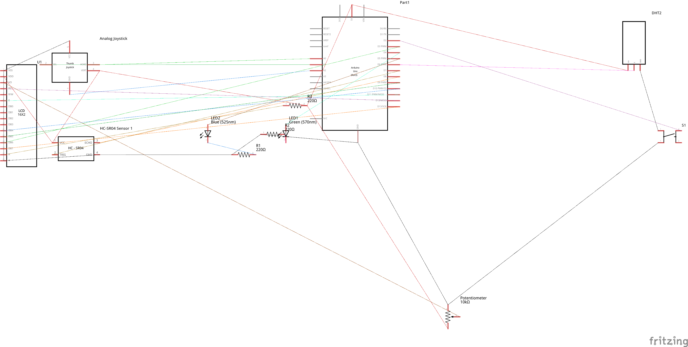
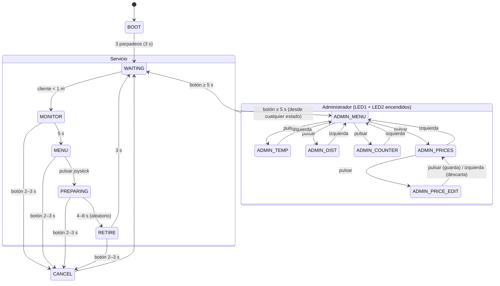

# Práctica 3 — Controlador de máquina expendedora

Controlador para una máquina expendedora de café sobre **Arduino UNO**. El sistema detecta la presencia de un cliente, muestra la temperatura y humedad ambiente, permite elegir un producto con el joystick, simula su preparación con una barra de progreso y un LED regulado por PWM. También ofrece un modo administrador para consultar sensores y modificar precios.

Todo el programa es **no bloqueante**: no se usa `delay()`, las tareas periódicas se planifican con **ArduinoThread**, el botón externo se gestiona con una **interrupción hardware** y un **watchdog** reinicia el sistema si el bucle principal se bloquea.

**Vídeo de demostración:** [enlace al vídeo](https://www.youtube.com/watch?v=eAMISLzXzlw)



---

## Índice

1. [Hardware](#1-hardware)
2. [Arquitectura software](#2-arquitectura-software)
3. [Recursos utilizados y por qué](#3-recursos-utilizados-y-por-qué)
4. [Detalles de implementación](#4-detalles-de-implementación)
5. [Problemas encontrados y soluciones](#5-problemas-encontrados-y-soluciones)
6. [Desarrollo y pruebas](#6-desarrollo-y-pruebas)

---

## 1. Hardware

### Componentes

Todos los componentes utilizados pertenecen al kit.

| Componente | Uso |
|---|---|
| Arduino UNO R3 | Microcontrolador (ATmega328P) |
| LCD 16x2 (HD44780) | Interfaz con el usuario, en modo 4 bits |
| Potenciómetro 10 kΩ | Contraste del LCD (V0) |
| Joystick analógico | Navegación (ejes X/Y) y selección (pulsador SW) |
| DHT11 (módulo de 3 pines) | Temperatura y humedad |
| HC-SR04 | Detección de presencia del cliente |
| Pulsador | Botón externo: cancelar / modo administrador |
| 2 LEDs + resistencias 220 Ω | LED1 (estado) y LED2 (progreso, PWM) |
| Protoboard y cables | Montaje |

### Fotos del montaje





### Esquemático (Fritzing)





El fichero fuente de Fritzing está en [`design.fzz`](design.fzz).

### Mapa de pines

| Pin Arduino | Conectado a | Notas |
|---|---|---|
| D2 | Botón externo | `INPUT_PULLUP`, activo a nivel bajo. **INT0** → interrupción hardware |
| D3 | LCD D6 | |
| D4 | LED1 | Salida digital |
| D5 | LED2 | **PWM** (Timer0) |
| D6 | DHT11 (señal) | |
| D7 | HC-SR04 Trig | |
| D8 | HC-SR04 Echo | |
| D9 | LCD D5 | |
| D10 | LCD D4 | |
| D11 | LCD E | |
| D12 | LCD RS | |
| D13 | LCD D7 | |
| A0 | Joystick X (VRx) | Lectura analógica |
| A1 | Joystick Y (VRy) | Lectura analógica |
| A2 | Joystick SW | `INPUT_PULLUP`, activo a nivel bajo |
| A5 | — (al aire) | Ruido analógico como semilla de `random()` |

El LCD se conecta en **modo 4 bits** (D0–D3 sin conectar) y con **RW a GND** (solo escritura). Los dos únicos pines con interrupción externa del UNO son D2 y D3; el botón ocupa D2 (INT0) y se reservó D3 para el LCD porque no necesita interrupción. LED2 va en D5 porque necesita un pin con PWM.

---

## 2. Arquitectura software

El programa es una **máquina de estados finita (FSM)**. Cada estado tiene:

- una **acción de entrada** (`enterState()`): se ejecuta una sola vez al entrar (dibujar la pantalla, apagar LEDs, elegir el tiempo de preparación…);
- una **función de actualización** (`updateX()`): se llama en cada iteración de `loop()` y decide si hay que cambiar de estado.



| Estado | Qué hace | Sale cuando |
|---|---|---|
| `BOOT` | "CARGANDO ..." y LED1 parpadea 3 veces (1 s cada parpadeo) | Pasan 3 s |
| `WAITING` | "ESPERANDO CLIENTE" | Hay un cliente a menos de 1 m |
| `MONITOR` | Temperatura y humedad, con cuenta atrás de 5 s | Pasan 5 s |
| `MENU` | Lista de productos con precio; arriba/abajo para moverse | Se pulsa el joystick |
| `PREPARING` | "Preparando Café" + barra de progreso + LED2 con brillo proporcional | Pasa el tiempo aleatorio (4–8 s) |
| `RETIRE` | "RETIRE BEBIDA" con cuenta atrás de 3 s | Pasan 3 s |
| `CANCEL` | Apaga LED2 y reinicia la interacción | Inmediatamente → `WAITING` |
| `ADMIN_MENU` | Las 4 opciones del administrador | Se pulsa una opción |
| `ADMIN_TEMP` | Temperatura y humedad en tiempo real | Izquierda |
| `ADMIN_DIST` | Distancia del sensor en cm, en tiempo real | Izquierda |
| `ADMIN_COUNTER` | Segundos desde el arranque | Izquierda |
| `ADMIN_PRICES` | Lista de productos | Pulsar (editar) / izquierda (volver) |
| `ADMIN_PRICE_EDIT` | Precio nuevo, en pasos de ±0,05 € | Pulsar (guarda) / izquierda (descarta) |

### Estructura de `loop()`

```cpp
void loop()
{
  wdt_reset();                    // watchdog: "sigo vivo"
  threads.run();                  // tareas periódicas: sonar y DHT
  handleButton();                 // cancelar / modo admin (puede cambiar de estado)
  JoyEvent ev = readJoystick();   // un evento por movimiento
  uint32_t elapsed = millis() - stateStart;

  switch (state) { /* updateX(elapsed / ev) del estado actual */ }
}
```

Ninguna de estas llamadas bloquea: cada iteración del bucle dura unos pocos milisegundos (como mucho unas decenas cuando toca leer un sensor), así que el sistema responde siempre al botón y al joystick.

---

## 3. Recursos utilizados y por qué

### 3.1 ArduinoThread — tareas periódicas

Se usan dos `Thread` dentro de un `ThreadController`:

| Hilo | Periodo | Qué hace |
|---|---|---|
| `sonarThread` | 100 ms | Mide la distancia con el HC-SR04 y actualiza la presencia del cliente |
| `dhtThread` | 2 s | Lee temperatura y humedad del DHT11 |

**Por qué:** los dos sensores son lentos y tienen sus propias restricciones de tiempo, distintas de las de la interfaz.

- El **HC-SR04** necesita al menos ~60 ms entre medidas para que no se mezclen ecos. Con 100 ms se detecta al cliente con rapidez sin saturar el sensor.
- El **DHT11** no puede leerse más de una vez por segundo, y cada lectura bloquea ~25 ms con las interrupciones desactivadas. Leerlo cada 2 s y **guardar el último valor** permite que cualquier pantalla (MONITOR, ADMIN_TEMP) lo muestre al instante sin esperar al sensor.

Así, el resto del programa nunca lee los sensores directamente: solo consulta las variables `distanceCm`, `customerPresent`, `temperature` y `humidity`. ArduinoThread es planificación **cooperativa**: `threads.run()` comprueba en cada `loop()` si a algún hilo le toca ejecutarse.

### 3.2 Interrupción hardware — botón externo

El botón está en **D2 (INT0)** con `attachInterrupt(..., CHANGE)`, es decir, la ISR se ejecuta en cada flanco (pulsar y soltar).

**La ISR es mínima:** solo guarda marcas de tiempo. No escribe en el LCD, no usa `Serial` ni `delay()`, y no cambia de estado.

```cpp
void isrButton()
{
  uint32_t now = millis();
  bool down = digitalRead(PIN_BUTTON) == LOW;
  if (down == btnDown) return;                    // rebote: el nivel no cambió
  if (now - btnLastEdge < BTN_DEBOUNCE_MS) return; // rebote: demasiado pronto
  btnLastEdge = now;
  btnDown = down;
  if (down) btnPressStart = now;
  else { btnPressDuration = now - btnPressStart; btnReleased = true; }
}
```

La **decisión** se toma en `loop()` (`handleButton()`), que es donde es seguro cambiar de estado y dibujar en el LCD:

- **Cancelar (2–3 s):** se decide **al soltar**, comprobando la duración de la pulsación. No puede decidirse mientras se mantiene pulsado, porque una pulsación de 5 s también pasa por la ventana de 2–3 s.
- **Administrador (≥ 5 s):** se dispara **en cuanto** se alcanzan los 5 s, aunque el botón siga pulsado, para que el usuario vea la respuesta sin tener que soltar. Una bandera (`longFired`) evita que esa misma pulsación cuente también como cancelación al soltarla.

Detalles importantes:

- **Variables `volatile`** compartidas entre la ISR y `loop()`.
- **Copia atómica:** en AVR (8 bits) leer un `uint32_t` no es atómico; la ISR podría modificarlo a mitad de la lectura. Por eso `handleButton()` copia las variables entre `noInterrupts()` e `interrupts()`.
- **Indicación visual:** mientras el botón lleva pulsado entre 2 y 3 s (y se puede cancelar), LED1 se enciende: soltar en ese momento cancela.

### 3.3 Watchdog

```cpp
void setup()
{
  MCUSR = 0;          // borra la causa del último reset
  wdt_disable();      // tras un reset por watchdog sigue activo: desactivarlo ya
  /* ... inicialización ... */
  wdt_enable(WDTO_2S);
}

void loop()
{
  wdt_reset();
  /* ... */
}
```

- **Timeout de 2 s:** la iteración más lenta del bucle normal es una lectura del DHT (~25 ms) o un timeout del sonar (≤ ~75 ms), muy por debajo de 2 s. Si el programa se queda colgado (bucle infinito, librería bloqueada, sensor que no responde…), el microcontrolador se reinicia solo y vuelve a `BOOT`.
- **`MCUSR = 0` + `wdt_disable()` al principio:** tras un reset provocado por el watchdog, este **sigue activo** con el timeout mínimo (~16 ms). Si no se desactiva al inicio, el propio `setup()` podría ser interrumpido una y otra vez.
- **Se activa al final de `setup()`:** la inicialización incluye llamadas lentas de librerías (`lcd.begin()`), que no tienen por qué entrar en el presupuesto de tiempo del watchdog.

### 3.4 Sin `delay()` — temporización con `millis()`

Todas las esperas (parpadeo del arranque, 5 s de MONITOR, preparación, 3 s de RETIRE, duración de las pulsaciones) se calculan como `millis() - stateStart`, donde `stateStart` se guarda al entrar en cada estado. El parpadeo de `BOOT`, por ejemplo, se deriva del tiempo transcurrido (`elapsed % 1000 < 500`) y no de un contador, de modo que una iteración más lenta no lo desincroniza.

Las únicas esperas activas están dentro de librerías y son muy cortas: el pulso de disparo del HC-SR04 (10 µs), la señal de inicio del DHT11 (~20 ms) y la inicialización del LCD (solo en `setup()`).

### 3.5 PWM — LED2

LED2 está en D5 (PWM). Durante `PREPARING` su brillo es proporcional al progreso:

```cpp
analogWrite(PIN_LED2, 255 * elapsed / prepDuration);
```

### 3.6 ¿Por qué no TimerOne?

TimerOne sirve para generar **interrupciones periódicas por temporizador** (Timer1). En esta práctica:

- la interrupción que pide el enunciado es la del **botón**, que es una interrupción **externa** (INT0), no de temporizador;
- las tareas periódicas (sensores) no tienen requisitos de tiempo estrictos y ya están cubiertas por ArduinoThread.

Una ISR de temporizador no aportaba nada y habría añadido otra fuente de concurrencia (más variables compartidas que proteger), así que no se usa.

---

## 4. Detalles de implementación

### 4.1 Detección de presencia (HC-SR04)

- `pulseIn()` con **timeout de 25 ms** (~4 m de alcance), para que la medida nunca bloquee más de lo necesario. Si no hay eco se devuelve `DIST_NONE` ("Fuera de rango" en el modo administrador).
- Distancia en cm = microsegundos / 58 (ida y vuelta a ~343 m/s).
- Se exigen **2 lecturas consecutivas** a menos de 1 m para considerar que hay un cliente, de forma que un eco espurio no despierte la máquina.

### 4.2 DHT11

- Si una lectura falla (error de checksum o timeout → `NAN`), se **conserva el último valor válido**. Hasta la primera lectura correcta el LCD muestra `--`.
- Una bandera `envUpdated` indica que ha llegado un valor nuevo, para redibujar la pantalla solo cuando cambia.
- El código compila con `DHT11` para la placa real y `DHT22` para el simulador (Wokwi no tiene DHT11), seleccionado con la macro `SIMULATION`.

### 4.3 LCD

- **Sin parpadeo:** solo se usa `lcd.clear()` al cambiar de estado. Dentro de un estado, cada línea se reescribe rellenada con espacios hasta 16 caracteres (`printRow()`), y solo cuando el contenido cambia (cuenta atrás, porcentaje, distancia…).
- **Caracteres personalizados** (`createChar`):
  - huecos 1–4: celdas parciales de la barra de progreso (1–4 de las 5 columnas de píxeles), con lo que la barra de 12 celdas tiene una resolución de 60 pasos;
  - hueco 5: la **é** de "Preparando Café", que no existe en la ROM del HD44780;
  - el hueco 0 no se usa porque el carácter 0 terminaría las cadenas de C.
- `0xDF` es el símbolo de grado (°) y `0xFF` un bloque lleno, ambos en la ROM del LCD.

### 4.4 Joystick

- Los ejes se convierten en **eventos** (`UP`, `DOWN`, `LEFT`, `RIGHT`, `PRESS`) con **histéresis**: el evento se genera al salir de la zona muerta (< 300 o > 723) y no se vuelve a generar hasta que la palanca vuelve al centro (400–623). Así, un movimiento = un evento, aunque se mantenga la palanca.
- El pulsador SW tiene antirrebote de 30 ms por software (se consulta en cada `loop()`).
- La orientación de los ejes es distinta en el simulador y en el módulo real; se ajusta con las constantes `JOY_UP_IS_HIGH` / `JOY_LEFT_IS_HIGH` según la macro `SIMULATION`.

### 4.5 Productos y precios

```cpp
struct Product { const char* name; uint16_t priceCents; };

Product products[] = {
  {"Cafe Solo", 100}, {"C. Cortado", 110}, {"Cafe Doble", 125},
  {"C. Premium", 150}, {"Chocolate", 200},
};
```

- Los precios se guardan en **céntimos** (enteros): los pasos de ±0,05 € son exactos, sin errores de redondeo de `float`, y además avr-libc no soporta `%f` en `printf`.
- Los nombres tienen como máximo 11 caracteres para que cada línea quepa en 16: cursor (1) + nombre (11) + precio (4, "1.50").
- Los precios modificados por el administrador se guardan en RAM (el enunciado no exige persistencia en EEPROM) y se ven inmediatamente en el menú del cliente.

### 4.6 Listas desplazables (`ListView`)

El menú de productos, el menú de administrador y la lista de precios son la misma estructura: una ventana de 2 líneas sobre `count` elementos, con un cursor `>` y una función que da formato a cada elemento.

```cpp
struct ListView
{
  uint8_t count;
  void (*format)(uint8_t i, char* out);
  uint8_t selected;
  uint8_t top;   // elemento mostrado en la primera línea
};
```

Así, la navegación arriba/abajo y el desplazamiento de la ventana se implementan una sola vez (`listMove()`, `drawList()`).

### 4.7 Modo administrador

- Se entra y se sale manteniendo el botón **≥ 5 s desde cualquier estado** (incluido `BOOT` o una preparación en curso, que se aborta).
- LED1 y LED2 encendidos mientras se está en el modo administrador. Se usa `digitalWrite()` en LED2, lo que también detiene el PWM si había una preparación en marcha.
- Al volver con "izquierda" se regresa a la opción de la que se venía, no al principio de la lista.
- Al salir se vuelve al inicio del modo Servicio (`WAITING`).
- Las opciones se abreviaron para que quepan en el LCD con el cursor: "Ver distancia" y "Modif. precios".
- La cancelación (2–3 s) se ignora en el modo administrador.

### 4.8 Tiempo de preparación aleatorio

```cpp
do
  prepDuration = random(PREP_MIN_MS, PREP_MAX_MS + 1);  // [4000, 8000] ms
while (prepDuration == last);
```

La semilla se toma de `analogRead(A5)` (pin al aire, ruido analógico) y se vuelve a sortear si sale el mismo valor que la vez anterior, para que dos preparaciones seguidas nunca tarden lo mismo.

---

## 5. Problemas encontrados y soluciones

### En el simulador

| Problema | Causa | Solución |
|---|---|---|
| La temperatura y la humedad no aparecían en el LCD | avr-libc no soporta el ancho variable `%*d` en `printf`: la salida se aborta | Formato literal `"%2d"` |
| El botón "no cancelaba" al mantenerlo pulsado | Al mantenerlo más de 5 s se activa el modo administrador, que por diseño no cancela | Comportamiento correcto; se añadió LED1 como indicador de la ventana de cancelación |

### En la placa real

| Problema | Causa | Solución |
|---|---|---|
| Al arrancar se entraba directamente en modo administrador | El pulsador de 4 patas estaba conectado por dos patas unidas internamente: D2 siempre a GND | Girar el pulsador 90° / usar patas en diagonal |
| LCD encendido pero sin caracteres | Contraste (V0) mal ajustado | Ajustar el potenciómetro |
| Temperatura `--` | El módulo DHT11 no tiene los pines serigrafiados; el orden era GND, VCC, señal | Recablear según el orden real |
| Siempre "ESPERANDO CLIENTE" / "Fuera de rango" | Trig y Echo del HC-SR04 intercambiados, y mala conexión de alimentación | Recablear |
| Joystick invertido (arriba ↔ abajo, izquierda ↔ derecha) | El módulo del kit tiene los ejes al revés que el del simulador | Constantes de orientación distintas según `SIMULATION` |
| Fallo al subir el programa (`/dev/ttyS0`) | La placa se desconectó al recablear y PlatformIO eligió otro puerto | Reconectar el USB; `upload_port = /dev/ttyACM*` en `platformio.ini` |

---

## 6. Desarrollo y pruebas

### Entorno

- **PlatformIO** (en lugar del IDE de Arduino), con dos entornos que comparten el mismo código:
  - `uno`: placa real (DHT11, orientación del joystick del kit);
  - `wokwi`: simulador (compila con `-DSIMULATION`: DHT22 y orientación del joystick de Wokwi).
- **Wokwi** (extensión de VS Code) con el circuito completo en [`p3/diagram.json`](p3/diagram.json), para probar cada fase antes de montarla.
- Librerías: `ArduinoThread`, `DHT sensor library` (Adafruit), `Adafruit Unified Sensor`, `LiquidCrystal`.

### Metodología

El plan de trabajo siguió tres etapas, de menor a mayor coste de corregir un error:


1. **Fritzing:** primero se diseñó el circuito y el mapa de pines (qué pines necesitan PWM o interrupción, alimentación compartida en la protoboard). Así se detectaron errores de conexión antes de tocar ningún cable.
2. **Wokwi:** con el circuito definido, se replicó en el simulador y se desarrolló todo el código sobre él. Cada fase se probó en simulación sin riesgo de dañar componentes y sin tener que recablear.
3. **Hardware:** con el programa ya funcionando en simulación, se montó el circuito real y se subió el mismo código. Los problemas que aparecieron en esta etapa fueron solo de montaje y de diferencias entre los componentes reales y los simulados (ver [sección 5](#5-problemas-encontrados-y-soluciones)), no de lógica.

Dentro de la etapa de Wokwi, el desarrollo se hizo por fases, probando cada una antes de pasar a la siguiente: `BOOT` → sensor de distancia → DHT / `MONITOR` → `MENU` → `PREPARING` / `RETIRE` → `CANCEL` → modo administrador → watchdog.

La lógica del botón y de la máquina de estados también se probó **en el PC**, compilando `main.cpp` con g++ contra versiones simuladas de las cabeceras de Arduino (tiempo, pines e ISR controlados desde el test), para verificar casos límite como pulsaciones justo por debajo, dentro y por encima de la ventana de 2–3 s, pulsaciones de más de 5 s o la secuencia completa del modo administrador.

Por último, se probó todo el flujo en la placa real.

### Compilar y subir

```bash
cd p3
pio run -e uno -t upload    # placa real
pio run -e wokwi            # simulador (después: "Wokwi: Start Simulator")
```

### Estructura del proyecto

```
p3/
├── README.md            ← este documento
├── design.fzz           ← esquema Fritzing
├── design/              ← exportaciones del esquema
├── img/                 ← fotos del montaje
└── p3/                  ← proyecto PlatformIO
    ├── platformio.ini
    ├── diagram.json     ← circuito de Wokwi
    ├── wokwi.toml
    └── src/main.cpp     ← código fuente
```
